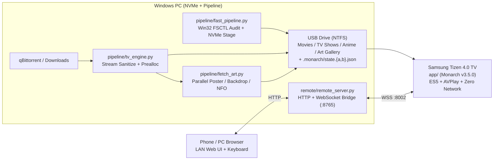

<div align="center">


# Monarch (`v3.5.0`)

**Offline-first 4K USB Media Shelf, AVPlay Theater & Art Gallery for Samsung Tizen 4.0 TVs — paired with a zero-dependency Phone/PC WebSocket Remote and high-speed NVMe-to-HDD media pipeline.**

[-1428A0?style=flat-square&logo=samsung)](https://developer.samsung.com/smarttv/develop/specifications/web-engine-specifications.html)
[-16a34a?style=flat-square)](app/config.xml)
[](app/app.js)
[](remote/remote_server.py)
[](LICENSE)

</div>

---

## Why Monarch?

Built for Samsung Tizen 4.0 TVs (tested on `UE65NU7100`), Monarch replaces Samsung's barebones USB file browser with a responsive 1080p cinema interface that runs **100% offline** with zero network privileges in `config.xml`. Every movie, series, anime, poster, backdrop, and `.nfo` lives directly on your USB drive, while **Continue Watching** and preferences automatically persist across app updates via dual alternating backup files (`.monarch/state.a.json` & `state.b.json`) on the USB drive.

---

## Screenshots

| Home Spotlight & Shelves | 4K Player OSD & Skip Intro |
| :---: | :---: |
|  |  |
| *Spotlight Hero, Continue Watching, Movies, TV Shows, Anime & Top Nav* | *AVPlay 4K playback with Skip Intro (`+85s`), Subtitles & Next Episode* |

| In-Player Episode Carousel | Customize & Theme Drawer |
| :---: | :---: |
|  |  |
| *Browse and jump episodes without leaving playback* | *Layout presets, accent colors, backdrop dimness & idle screensaver* |

| 16:9 Art Gallery Screensaver | Monarch Phone / PC Web Remote |
| :---: | :---: |
|  |  |
| *Curated 16:9 Art Gallery & idle screensaver mode* | *Zero-dependency LAN WebSocket remote & 1-tap TV App Launcher* |

---

## Architecture



---

## Key Features

### 1. Samsung TV App (`app/`, v3.5.0)
- **Zero Network Privileges:** Only `filesystem.read`, `filesystem.write` (scoped to `.monarch/` backup), `tv.inputdevice`, `avplay`, and `application.launch` in [`app/config.xml`](app/config.xml).
- **Update-Proof Continue Watching & Settings:** Stores state in `localStorage` **plus** dual alternating `.monarch/state.a.json` and `state.b.json` files on USB so progress, watched marks, and UI settings survive reinstalls.
- **Native Shelves:** Automatic routing for **Movies**, **TV Shows**, **Anime** (`D:\Anime` or anime title matching), and **Art Gallery**.
- **AVPlay Theater:** Multi-episode carousel overlay, Up Next prompt, Skip Intro (`+85s`), audio track switcher, SRT/internal subtitle switcher + timing sync, and safe invalid-state recovery.
- **Tizen 4.0 Safe:** Strict ES5 (`var`, `function`, zero `const`/`let`/arrows) and Chromium M56-compatible CSS.

### 2. Monarch Remote (`remote/`)
- **Zero Third-Party Dependencies:** Pure Python 3 standard library HTTP server + RFC 6455 WebSocket client to Samsung `wss://<TV_IP>:8002`.
- **Phone & PC Friendly:** Responsive touch D-pad with hold-to-repeat, Volume/Channel rockers, Playback controls, Color keys (`A/B/C/D`), expandable `123 Numbers` drawer, text input, and PC keyboard shortcuts (arrows, `Enter`, `Esc`, `Space`, `+/-`, digits).
- **1-Tap TV App Launcher:** Launch `Monarch`, `TizenTube`, `Stremio`, `Netflix`, `Prime Video`, `Spotify`, or `Samsung Gallery` straight from your phone.

### 3. High-Speed Media & Artwork Pipeline (`pipeline/`)
- **`tv_engine.py`:** `ffprobe` stream planner (keeps video, prioritizes English audio & `subrip`/`srt` subs within Samsung's 30-stream demuxer limit), Win32 `SetEndOfFile` NTFS contiguous preallocation, same-drive NVMe temp staging, and automatic art fetching on completion.
- **`fetch_art.py`:** Multi-threaded (`ThreadPoolExecutor`) local `poster.jpg`, `backdrop.jpg`, and `.nfo` fetcher (TVmaze, IMDb suggest, iTunes, Wikipedia, `ffmpeg` keyframe fallback) plus `--prestage-qbit` for queued/incomplete torrents.
- **`fast_pipeline.py`:** Unified one-command orchestrator with sub-second Win32 `FSCTL_GET_RETRIEVAL_POINTERS` auditing, smart defrag thresholds, and byte-resumable NVMe fallback.

---

## Quick Start

### 1. Sideload the TV App (`app/`)
1. Enable **Developer Mode** on your Samsung TV (**Apps** -> press `1 2 3 4 5` -> **ON** -> enter your PC's LAN IP -> cold reboot TV). See [`app/TV_CHECKLIST.md`](app/TV_CHECKLIST.md) for the full diagnostic & safety walkthrough.
2. Package and install with [`tests/pack_wgt.py`](tests/pack_wgt.py) and `apps2samsung-cli` (or Tizen Studio):
   ```powershell
   python tests/pack_wgt.py
   apps2samsung-cli.exe install usb-shelf.wgt --tv 192.168.1.64
   apps2samsung-cli.exe launch UsbShelf01.UsbShelf --tv 192.168.1.64
   ```

### 2. Start the Phone & PC Remote (`remote/`)
```powershell
python remote/remote_server.py --tv 192.168.1.64 --port 8765
```
- Open **`http://localhost:8765`** on your PC or **`http://<PC_LAN_IP>:8765`** on your phone (same Wi-Fi).
- Accept the **Allow?** prompt once on the TV; the token is saved to `remote/tv_token.json`.

### 3. Prepare Your USB Drive (`pipeline/`)
Organize your USB drive cleanly:
```text
D:\
├── Movies\          # Movie Title (Year)\Movie Title (Year).mkv + poster.jpg + backdrop.jpg + movie.nfo
├── TV Shows\        # Show Name\Season 01\Show Name - S01E01.mkv + poster.jpg + backdrop.jpg + tvshow.nfo
├── Anime\           # Anime Name\Season 01\Anime Name - S01E01.mkv + poster.jpg + backdrop.jpg + tvshow.nfo
└── Art Gallery\     # High-res 16:9 paintings / wallpapers + gallery.json
```
Run the unified pipeline:
```powershell
python pipeline/fast_pipeline.py
```

---

## Remote Keymap (TV & Web UI)

| Action | TV Remote | Web Remote / PC Keyboard |
| :--- | :--- | :--- |
| Navigate / Select | D-Pad / OK | Arrows / `Enter` |
| Back / Exit Overlay | Return / Exit | `Esc` / `Backspace` |
| Play / Pause | Play / Pause | `Space` |
| Seek (`-10s` / `+10s`) | Left / Right (in player) | `←` / `→` |
| Toggle Subtitles | Red (`A`) | `A - Subs` |
| Cycle Audio Track | Green (`B`) | `B - Audio` |
| Subtitle Sync (`-` / `+`) | Yellow (`C`) / Blue (`D`) | `C - Sync-` / `D - Art` |
| Info / Technical Badges | Info | `Info` |

---

## Tizen 4.0 Hardware & Engine Notes

- **Chromium M56 ES5 Target:** Tizen 4.0 (2018 Samsung TVs such as `UE65NU7100`) runs **Chromium M56**. `const`/`let`, arrow functions, optional chaining, and WebAssembly (`wasm32-unknown-unknown` / Rust-to-WASM) are **not supported** on Tizen 4.0 (WASM requires Tizen 5.5+ / Chromium M69+).
- **30-Stream Limit:** Samsung's AVPlay demuxer rejects MKVs with `> 30` tracks; `pipeline/tv_engine.py` automatically strips bloated foreign/PGS tracks down to `<= 5` clean streams.

---

## Verification & Tests

```powershell
# TV App ES5 syntax, DOM & storage unit checks
node tests/verify_unit.js

# Monarch Remote unit & mock WebSocket TV protocol tests
python remote/test_remote.py
```

---

## License

MIT — see [LICENSE](LICENSE).
